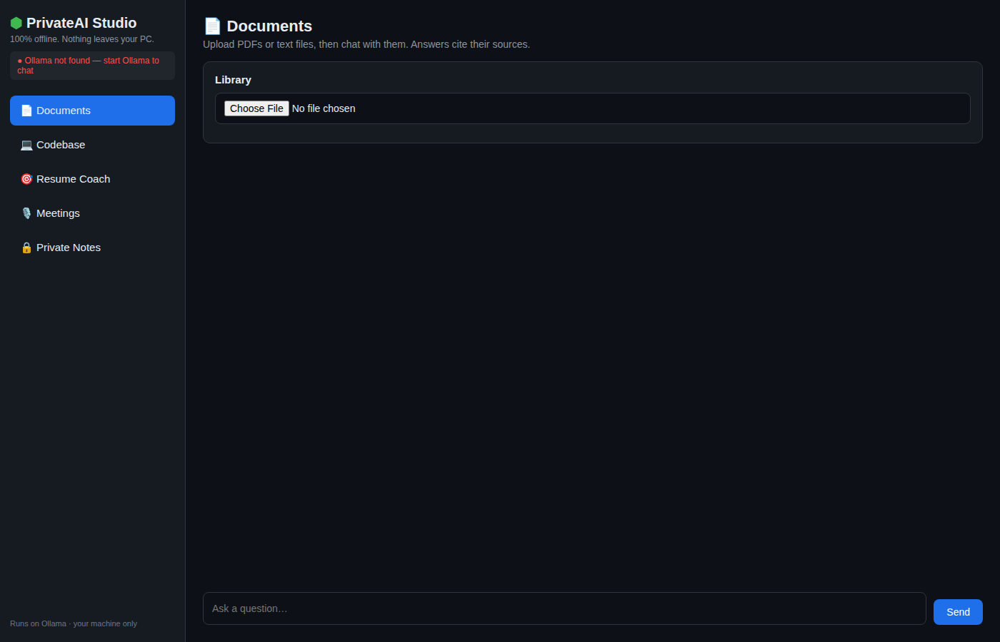

# PrivateAI Studio

Every private AI tool in one place, 100% offline. Nothing you upload ever leaves your PC.



## The five modes

- **Documents** - Upload PDFs or text files, then chat with them. Every answer cites its sources, and if the answer isn't in your documents, it says so instead of inventing one.
- **Codebase** - Upload a zip of a codebase and ask where things live and how they work. Answers reference file paths.
- **Resume Coach** - Honest, offline feedback on your CV against a job description: matches, gaps, and three concrete fixes. No flattery.
- **Meetings** - Turn a transcript into a summary, decisions, action items, and open questions.
- **Private Notes** - Notes encrypted with AES at rest. Your password is never stored.

## How it works

Documents and code are split into chunks, embedded with a local model, and stored in SQLite. When you ask a question, the most relevant chunks are retrieved and handed to a local LLM with a strict "answer only from this context" instruction. This is called RAG (retrieval-augmented generation).

## Requirements

- Python 3.10 or newer
- [Ollama](https://ollama.com) running on your machine

## Quickstart

```bash
# 1. Install Ollama, then pull the models (one time)
ollama pull llama3.1
ollama pull nomic-embed-text

# 2. Install the app
pip install -r requirements.txt

# 3. Run it
uvicorn app.main:app --reload
```

Open http://127.0.0.1:8000 in your browser.

You can pick different models with environment variables:

```bash
CHAT_MODEL=mistral EMBED_MODEL=nomic-embed-text uvicorn app.main:app
```

## Project structure

```
privateai-studio/
  app/
    main.py          # FastAPI app, static files, router wiring
    database.py      # SQLite: documents, chunks, chats, messages, notes
    rag.py           # chunking, Ollama embeddings, similarity search, extractors
    llm.py           # Ollama chat with token streaming
    routers/
      docs.py        # document upload + cited Q&A
      code.py        # codebase zip upload + code Q&A
      resume.py      # CV vs job description analysis
      meetings.py    # transcript summarizer
      notes.py       # encrypted notes
    static/          # web UI (vanilla JS, dark theme)
```

## API

| Method | Endpoint | What it does |
|---|---|---|
| POST | /api/docs/upload | Upload a PDF/TXT/MD file |
| POST | /api/docs/ask | Stream a cited answer |
| POST | /api/code/upload | Upload a codebase zip |
| POST | /api/code/ask | Stream a code answer |
| POST | /api/resume/analyze | CV vs job description feedback |
| POST | /api/meetings/summarize | Transcript summary |
| POST | /api/notes | Save an encrypted note |
| GET | /api/notes | List note titles |
| POST | /api/notes/{id}/open | Decrypt a note |
| GET | /api/health | Check the Ollama connection |

## Honest limitations

- You need Ollama and a few GB of model downloads; answers are slower than cloud AI on weak machines.
- Embeddings and chat quality depend on the models you pull.
- Meeting notes work from transcripts; live audio transcription is on the roadmap.
- This is a personal tool, not hardened for multi-user hosting.

## Roadmap

- Scanned PDFs via OCR, Word and PowerPoint support
- One-click modes: summarize, explain simply, extract action items
- Click-to-source highlighting in the document
- Audio transcription for meetings
- Conversation memory across sessions

## License

MIT. Not affiliated with Ollama or Meta.
